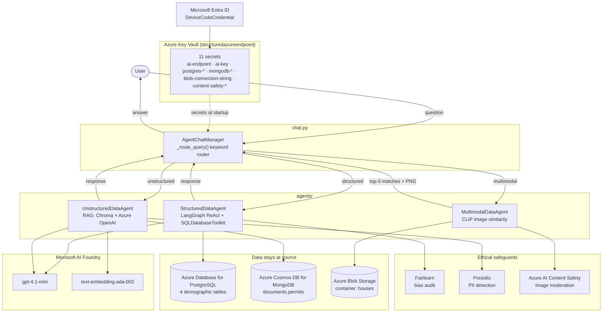
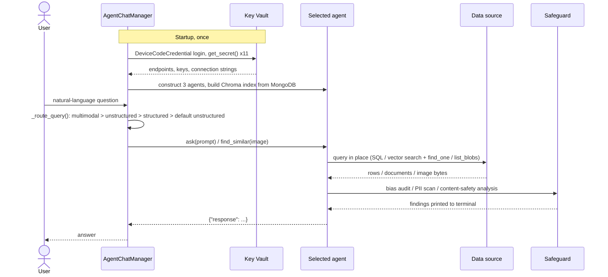

# Architecture: Neighborhood Insights Multi-Agent Assistant

A chat assistant that answers natural-language questions about neighborhoods by routing
each query to one of three specialised agents. Every agent reads from a different data
system, applies its own ethical check before answering, and never copies data out of
its source. All credentials come from a single Azure Key Vault at startup.

## System diagram

## Request lifecycle

## Components

### Chat manager (`chat.py`)

- Authenticates once with Microsoft Entra ID using a device-code flow and pulls all
  secrets from Key Vault. No credential appears in code or environment variables.
- Instantiates the three agents with their secrets and model deployment names.
- Routes each message with a rule-based keyword router, checked in priority order:
  1. **multimodal** if the message mentions images, photos, or "a house like mine"
  2. **unstructured** if it mentions permits, documents, reports, approvals
  3. **structured** if it mentions demographics, prices, averages, counts, income
  4. default to **unstructured**
- Wraps each agent call in a try/except so a failing data source produces a readable
  error rather than crashing the session.
- Writes an **audit log** (`logs/audit_log.jsonl`, one JSON object per query) recording
  the agent invoked, its data source, the ethical check that ran, what it found, the
  action taken (advisory, redaction, exclusion, block, or none), and latency. Errors
  are logged too. A one-line `[Audit]` summary is printed after every answer.

### Structured Data Agent (`agents/structured_data_agent.py`)

| Aspect | Implementation |
|---|---|
| Data source | Azure Database for PostgreSQL Flexible Server, tables `neighborhood_houses`, `neighborhood_schools`, `neighborhood_hospitals`, `education_survey` |
| Reasoning | LangGraph ReAct agent with LangChain `SQLDatabaseToolkit`, model `gpt-4.1-mini` |
| How it answers | The LLM inspects the schema, writes SQL, runs it against PostgreSQL, and summarises the result |
| Ethical check | **Bias audit with Fairlearn.** After every answer it discovers all tables, finds demographic columns by token match (gender, race, ethnicity, age, education, religion, disability, and others), and for each: binary columns get a selection-rate `MetricFrame` and demographic parity difference (flag above 0.10); numeric columns get a min/max mean ratio across groups (flag below 0.80); small categorical columns get a percentage cross-tab (flag when any category share differs by more than 20 points) |
| Action taken | When any finding is flagged, a **fairness advisory** naming the affected demographic columns and the top disparities is prepended to the answer |
| Output | `{"question": ..., "response": ..., "audit": {"ran", "findings": [...], "flagged"}}` |

### Unstructured Data Agent (`agents/unstructured_data_agent.py`)

| Aspect | Implementation |
|---|---|
| Data source | Azure Cosmos DB for MongoDB vCore, database `documents`, collection `permits` (one document per permit PDF, text extracted at load time) |
| Index | Chroma vector store persisted at `data/chroma_db_storage`, embeddings from `text-embedding-ada-002`. Built at startup from MongoDB, so no embeddings leave the user's machine |
| How it answers | Top-k (3) similarity search returns Mongo IDs. The full documents are re-fetched from MongoDB by `_id`, so the authoritative text always comes from the source, and passed as context to `gpt-4.1-mini` |
| Ethical check | **PII detection with Microsoft Presidio.** Both the source documents and the generated answer are scanned. Entities with confidence 0.85 or higher (excluding URLs) are printed with their type and score |
| Action taken | Any PII that leaked into the generated answer is **redacted** in place with `[ENTITY_TYPE]` placeholders before the answer is returned |
| Output | `{"response": ..., "sources": [mongo ids], "audit": {"pii_in_sources", "pii_in_answer", "redacted", "flagged"}}` |

### Multimodal Data Agent (`agents/multimodal_data_agent.py`)

| Aspect | Implementation |
|---|---|
| Data source | Azure Blob Storage, container `houses`, 13 JPEG images named by address |
| Model | OpenAI CLIP `clip-vit-base-patch32` via Hugging Face Transformers, run locally on CPU |
| How it answers | Every blob is downloaded, embedded alongside the query image, and ranked by cosine similarity. The top 3 addresses are returned and a comparison figure is saved to `similar_houses.png` |
| Ethical check | **Azure AI Content Safety image analysis.** The user's **query image is screened first**; then each blob is analysed for Hate, SelfHarm, Sexual, and Violence. Results are cached per blob for the session |
| Action taken | A flagged query image **aborts the search**. Flagged blobs are **excluded from results** and the answer states how many were withheld |
| Output | `(matches, query_image, safety)` where `safety` holds the query-image verdict, per-blob severities, and the excluded list |

## Azure resources

| Resource | Purpose | Secret(s) in Key Vault |
|---|---|---|
| Azure Key Vault `structuredazureendpoint` | Holds every credential; RBAC authorization, caller needs Key Vault Secrets User | n/a |
| Microsoft AI Foundry (Azure OpenAI), US region | Deployments `gpt-4.1-mini` and `text-embedding-ada-002` | `ai-endpoint`, `ai-key` |
| Azure Database for PostgreSQL Flexible Server | Structured demographic data | `postgres-host`, `postgres-database`, `postgres-user`, `postgres-password` |
| Azure Cosmos DB for MongoDB vCore | Permit document text | `mongodb-connection-string`, `mongodb-database` |
| Azure Storage Account, container `houses` | House images | `blob-connection-string` |
| Azure AI Content Safety | Image moderation | `content-safety-endpoint`, `content-safety-key` |

Provisioning scripts, a Bicep template, and a secret verifier live in `infra/`.

## Data sovereignty and ethics by design

- **Data stays at source.** SQL runs inside PostgreSQL, documents are fetched by ID from
  MongoDB at answer time, and images are streamed from Blob Storage per request. Nothing
  is bulk-copied into the assistant.
- **Runtime-only artifacts.** The Chroma index and CLIP embeddings are regenerated on the
  user's machine and are not uploaded anywhere.
- **Audit before answer.** Each agent prints its bias, PII, or content-safety findings to
  the terminal on every query, so the operator sees the risk profile of the data behind
  the answer, not just the answer.
- **Checks are actionable.** Findings change the output: fairness advisories are added,
  leaked PII is redacted, unsafe images are withheld, and an unsafe query image stops the
  search. Every decision is recorded in the audit log.
- **Per-agent credentials.** Each data source has its own secret, so access can be
  narrowed per agent or per user with Key Vault RBAC without changing code.
- **Identity, not keys, for the vault.** Users authenticate as themselves through Entra ID.
  Removing a user's Key Vault role removes their access to every downstream system.

## Known limitations

- The router is keyword-based. Ambiguous questions fall through to the unstructured agent.
- The multimodal agent always uses `query-house-2.jpg`; the prompt text is not used to
  pick an image.
- Content Safety results are cached per blob only for the lifetime of the process. A
  production version would cache by blob ETag.
- The bias audit treats any column with 2 unique values as a binary outcome and any
  numeric column as a score, which can flag harmless disparities. Findings are advisory.
